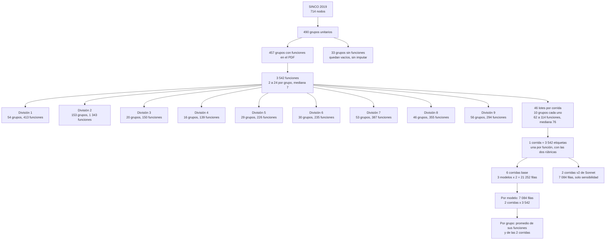
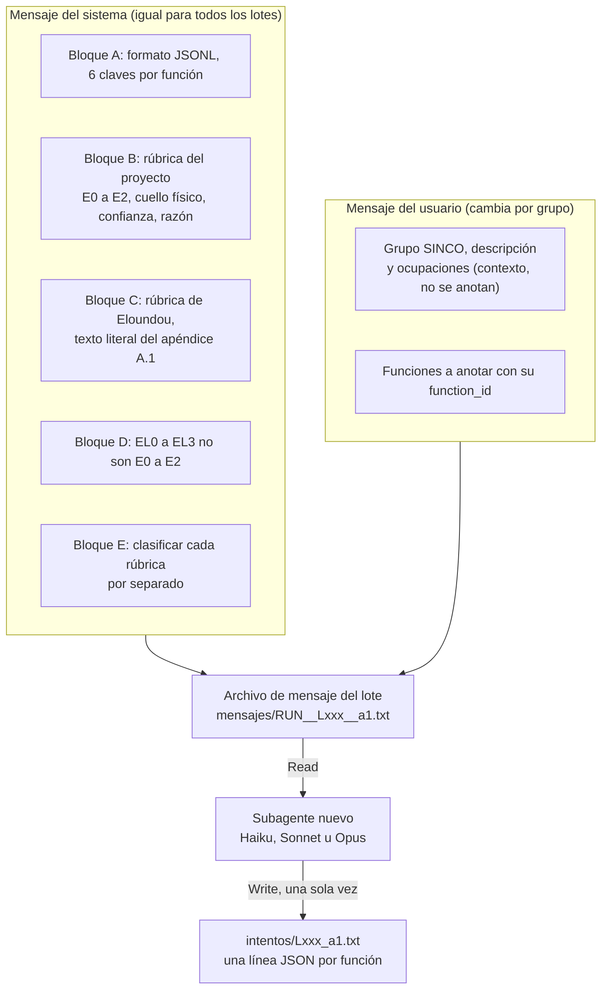
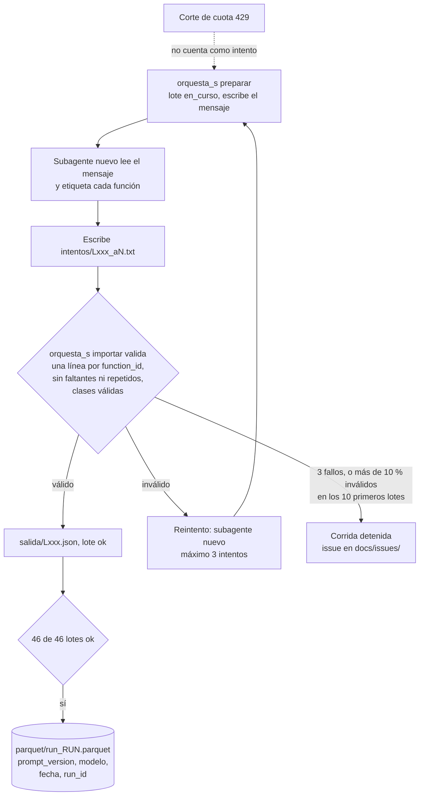
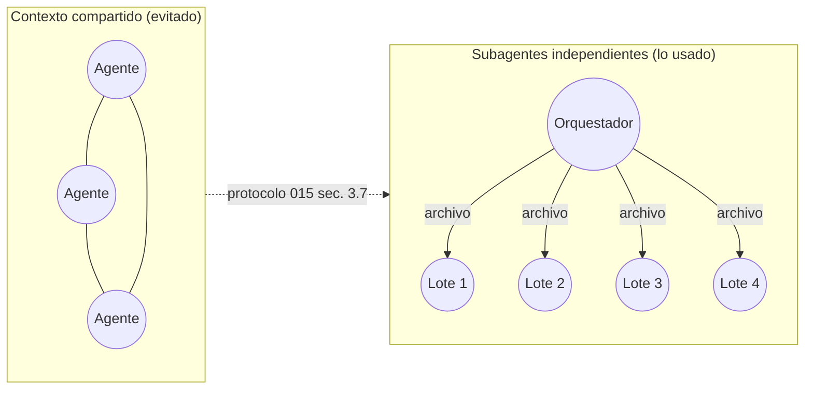
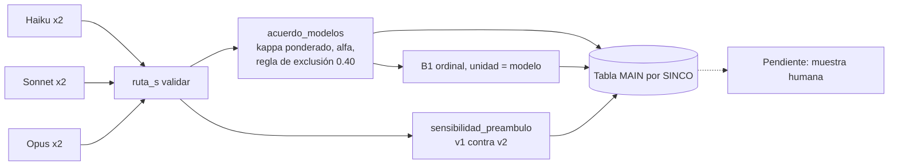
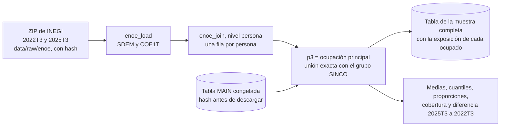

# Metodología: exposición a IA de las ocupaciones de SINCO 2019

- Fecha: 2026-10-25
- Estado: **resumen descriptivo, provisional y sin validar.** No es una decisión: resume lo decidido en `docs/decisions/` (001, 005, 011, 012, 015, 017, 018, 019) y lo ejecutado.
- Rótulo de todo lo que sigue: **exposición teórica por anotación de modelos; mide consistencia entre modelos, no exactitud.** No es riesgo de pérdida de empleo ni una estimación para México.

## 1. Qué se hace

Se estima qué tan expuesta está cada función de cada grupo unitario de SINCO 2019 a sistemas de IA. Tres modelos de lenguaje (Haiku, Sonnet y Opus) etiquetan cada función con dos rúbricas. Después se mide cuánto coinciden entre sí y cuánto se aparta cada uno, y los resultados se reúnen por clave SINCO en una tabla MAIN junto con el emparejamiento con O*NET.

| Pieza | Tamaño |
|---|---|
| Funciones SINCO anotadas | 3 542 |
| Grupos unitarios con funciones | 457 (de 490; 33 no traen funciones en el PDF y quedan vacíos, sin imputar) |
| Anotadores | Haiku, Sonnet, Opus, 2 corridas cada uno (6 corridas base) |
| Variante de prompt | `ann-s-v2`, solo Sonnet, 2 corridas (sensibilidad; no entra en MAIN) |

### 1.1 De dónde salen las 3 542 funciones y qué pasa con cada una

Cada una de las 3 542 funciones recibe, en cada corrida, **una fila** con `exposure_class`, `eloundou_class`, `physical_bottleneck`, `confidence` y `rationale`. Los índices por grupo de la tabla MAIN promedian esas filas.

| División SINCO | Grupos unitarios | Con funciones | Funciones | % de las 3 542 |
|---|---|---|---|---|
| 1. Funcionarios, directores y jefes | 60 | 54 | 413 | 11.7 % |
| 2. Profesionistas y técnicos | 159 | 153 | 1 343 | 37.9 % |
| 3. Trabajadores auxiliares en actividades administrativas | 21 | 20 | 150 | 4.2 % |
| 4. Comerciantes, empleados en ventas y agentes de ventas | 17 | 16 | 139 | 3.9 % |
| 5. Trabajadores en servicios personales y de vigilancia | 33 | 29 | 226 | 6.4 % |
| 6. Trabajadores agropecuarios, forestales, de caza y pesca | 33 | 30 | 235 | 6.6 % |
| 7. Trabajadores artesanales, de la construcción y otros oficios | 58 | 53 | 387 | 10.9 % |
| 8. Operadores de maquinaria industrial, ensambladores, choferes y conductores | 49 | 46 | 355 | 10.0 % |
| 9. Trabajadores en actividades elementales y de apoyo | 60 | 56 | 294 | 8.3 % |
| **Total** | **490** | **457** | **3 542** | **100 %** |

Dos consecuencias para leer los resultados: la división 2 pesa casi 4 de cada 10 funciones, y los índices de grupo salen de pocas funciones (mediana 7), así que un grupo de 2 funciones tiene índices con saltos grandes. Las medias por división de la API son promedios simples de grupos, no ponderados por funciones ni por empleo.

### 1.2 Cómo se mide la exposición a IA en la literatura

Fuente: *Workers' exposure to AI: What indicators tell us – and what they don't* (ILO Research Brief, febrero de 2026; Merola, Ernst, Samaan, del Rio-Chanona y Teutloff, CC BY 4.0), archivo `data/raw/Research Brief_Workers exposure to AI.pdf`. Su Tabla 1 resume la revisión de del Rio-Chanona et al. (2025). Casi todas las medidas parten de un mapa entre tareas y ocupaciones, casi siempre con las tareas de O*NET y sus pesos de importancia, y agregan la exposición de la tarea a la ocupación.

| Método | Trabajos clave | Fortalezas | Limitaciones |
|---|---|---|---|
| **Evaluación por expertos** | Frey y Osborne (2017); Brynjolfsson et al. (2018); Felten et al. (2018, 2021, 2023) | Aporta una visión cualitativa de la factibilidad de la IA; es transparente y fácil de interpretar; recoge el conocimiento experto sobre el avance tecnológico; se adapta a nuevas actualizaciones de los expertos | Posible sesgo de optimismo de los expertos; depende de percepciones humanas subjetivas; puede sobre o subestimar las capacidades futuras de la IA; las correspondencias por crowdsourcing pueden simplificar demasiado las tareas; las evaluaciones por ocupación (p. ej. Frey y Osborne) ignoran la heterogeneidad de las tareas |
| **Similitud semántica con patentes** | Mann y Püttmann (2023); Dechezleprêtre et al. (2020); Gathmann y Grimm (2022); Webb (2020); Prytkova et al. (2024); Septiandri et al. (2024) | Se basa en innovación tecnológica real; evita los sesgos del juicio experto; usa fuentes de datos a gran escala; los enfoques de PLN capturan profundidad semántica; es transparente en métodos como el de Webb (2020) | Los clasificadores de aprendizaje automático pueden ser opacos; los métodos de palabras clave pierden matices semánticos; las patentes pueden no reflejar la adopción económica; los datos antiguos pueden no captar la IA moderna; los embeddings de PLN reducen la interpretabilidad |
| **Evaluación con IA generativa** | Eloundou et al. (2024); Gmyrek et al. (2023, 2025); Septiandri et al. (2024) | Escalable y de bajo costo; refleja directamente las capacidades de la IA de frontera; puede evaluar sustitución y complementariedad; se actualiza fácilmente conforme evolucionan los modelos; es flexible a nivel de tarea o de ocupación | Los LLM pueden malinterpretar las tareas; los resultados son sensibles al diseño del prompt; los métodos carecen de transparencia; pueden heredar sesgos del modelo; suelen basarse en datos de O*NET de EE. UU., lo que limita la transferibilidad |

Nota de la fuente: varios estudios mezclan métodos (juicio experto, encuestas a trabajadores y evaluaciones con IA); la clasificación refleja el énfasis principal de cada trabajo.

**Cómo funciona cada familia, según el brief**
- **Expertos.** Frey y Osborne (2017) pidieron a expertos en aprendizaje automático que juzgaran si ocupaciones completas eran automatizables y entrenaron un clasificador con esos juicios; eso mezcla ocupación con tareas y, en retrospectiva, subestimó a la IA generativa. Felten et al. (2018, 2021, 2023) ligan los avances de IA que evaluaron expertos con las habilidades de O*NET mediante una matriz de relación construida por crowdsourcing y las agregan con los pesos de importancia (índice AIOE). Brynjolfsson et al. (2018) preguntan a trabajadores, lo que refleja percepciones más que capacidades.
- **Patentes.** Identifican patentes de IA o automatización y miden la similitud semántica entre sus textos y las tareas de O*NET: pares verbo-sustantivo en Webb (2020); embeddings de oraciones o BERT en Prytkova et al. (2024) y Septiandri et al. (2024). Siguen lo que se inventa, no lo que se adopta.
- **IA generativa.** Eloundou et al. (2024) preguntan a un modelo si podría hacer una tarea de O*NET "al menos tan bien como un humano" y en "la mitad del tiempo"; Gmyrek et al. (2023, 2025) lo extienden a tareas con códigos ISCO pidiendo justificación; Kogan et al. (2023) separan sustitución de complementariedad. El brief advierte que los modelos pueden sobrestimar sus propias capacidades, que pocos estudios hacen pruebas de robustez entre modelos y que se necesita validación externa.

**Límites que el brief atribuye a todas las medidas:** asumen tareas estáticas; no incluyen costos, salarios, productividad ni regulación; no dicen si habrá adopción; incorporan juicios subjetivos (de expertos, trabajadores o modelos); dependen sobre todo de datos de EE. UU.; y no comparten una definición de "exposición". Miden susceptibilidad tecnológica, no resultados laborales, y no deben leerse como predicciones de desplazamiento. Este proyecto adopta esa lectura en sus rótulos.

**Dónde cae lo que ya hay en el repositorio.** La probabilidad de automatización de Frey y Osborne que muestra la API es de la familia de expertos. El emparejamiento SINCO a O*NET por embeddings (sección 2) es una correspondencia por similitud semántica, como las que el brief menciona para extender las medidas a otros países; no mide exposición.

**Qué hacemos nosotros.** La medida de exposición de este proyecto pertenece a la familia de evaluación con IA generativa y la tomamos con **un sistema de agentes**, no con una consulta suelta a un solo modelo: un orquestador reparte el catálogo SINCO en lotes y lanza un subagente nuevo, sin memoria compartida, para cada lote; los subagentes son de tres modelos (Haiku, Sonnet y Opus, dos corridas cada uno), leen el lote y devuelven sus etiquetas solo por archivos; y el orquestador valida, reintenta y ensambla las tablas (secciones 4 y 5). Cada función recibe a la vez la rúbrica del proyecto y la de Eloundou, y el sistema se prueba con acuerdo entre modelos, una variante de prompt y un modelo de sesgo por modelo (secciones 6 y 7).

En relación con las debilidades que la literatura señala en esta familia:

| Debilidad señalada | Qué hace este sistema | Lo que no resuelve |
|---|---|---|
| Sensibilidad al diseño del prompt | Prompt versionado y con hash; una variante con otro preámbulo (`ann-s-v2`) para medir cuánto mueve el resultado | Solo se probó con un modelo y un cambio de redacción |
| Pocas pruebas de robustez entre modelos | Tres modelos y dos corridas cada uno; kappa entre y dentro de modelos; sesgo por modelo con B1 | Los tres son de la misma familia: el sesgo común no se identifica |
| Falta de transparencia | Razón por función, respuestas crudas conservadas, `run_id`, mensajes y reintentos registrados | El juicio de fondo sigue siendo el de un modelo |
| Dependencia de datos de EE. UU. | Se anotan las funciones del catálogo SINCO 2019 en español, no las tareas de O*NET; O*NET solo se usa para el emparejamiento | Las funciones del catálogo son una lista estática y oficial, no lo que se hace en cada puesto |
| Necesidad de validación externa | Está planeada una muestra humana independiente (015 §3.10) | **Pendiente:** sin ella no hay exactitud, solo consistencia |

Quedan igual que en toda la literatura: tareas estáticas, ninguna consideración de adopción ni de costos, y la subjetividad de un juicio hecho por modelos.

## 2. Datos y emparejamiento SINCO a O*NET

- **SINCO 2019** (INEGI): jerarquía de 714 nodos; el nivel más fino es el grupo unitario, con su descripción, ocupaciones de ejemplo y lista de funciones.
- **O*NET** (USDOL/ETA, CC BY 4.0): ocupaciones y tareas en inglés.
- **Emparejamiento por embeddings** (método A1): se compara el texto de cada grupo SINCO con el de cada ocupación O*NET con un modelo multilingüe (`bge-m3`, principal). Cada grupo conserva sus **2 mejores candidatos**, con `similitud` (coseno) y `margen`.
- **Peso entre candidatos:** `peso_softmax = softmax(similitud / tau)` entre los 2 candidatos, con `tau` provisional sin calibrar. **No es una probabilidad calibrada de acierto.**
- Es automático y **sin validar**. Estados: con coincidencia, baja confianza, sin coincidencia.

## 3. Las dos rúbricas

El prompt `ann-s-v1` entrega las dos rúbricas a la vez y pide clasificar cada una **de forma independiente**.

| | `exposure_class` (del proyecto) | `eloundou_class` (Eloundou et al. 2023, apéndice A.1) |
|---|---|---|
| Criterio | Cuánto podría hacer la IA o reducir el esfuerzo humano | Si un asistente tipo ChatGPT reduce el tiempo de la tarea a la mitad o más, con calidad equivalente |
| Clase 0 | E0: no reduce el esfuerzo | EL0: no baja el tiempo a la mitad (incluye lo que exige mucha interacción humana) |
| Clase 1 | E1: la IA ayuda mucho, pero un humano ejecuta o valida | EL1: exposición directa, el LLM solo basta |
| Clase 2 | E2: la IA puede completar la función | EL2: haría falta construir software sobre el LLM |
| Clase 3 | no existe | EL3: con capacidades de imagen (se funde en EL2) |
| Lo físico | Campo aparte (`physical_bottleneck`) | Se mete en EL0 |

Los números se parecen, pero no significan lo mismo: el "E2" del proyecto es la IA completando la función, mientras que el "EL1" de Eloundou ya es exposición directa y su "EL2" es exposición mediante software. Por eso el prompt dice que las escalas no se convierten una en otra. Cada modelo devuelve también `physical_bottleneck`, `confidence` y una `rationale` de máximo 25 palabras.

**Cómo se comparan en los datos** (primeras corridas de los tres modelos, 10 626 etiquetas): E0 y EL0 casi coinciden (todo E0 es EL0; EL0 es 90 % E0). Lo que el proyecto marca E1 se reparte 48 % EL1, 30 % EL2, 5 % EL3 y 16 % EL0; lo que marca E2 cae 65 % en EL2 y 29 % en EL1. A nivel de grupo, los dos índices medios tienen Spearman 0.96.

### 3.1 Las medidas de Eloundou: `alfa_S`, `beta_S` y `cota_sup_S`

Definidas en la decisión 001 (E-3) a partir de `eloundou_class`, con EL3 contado dentro de EL2. Cada una es una fracción de las funciones de un grupo SINCO.

| Medida | Fórmula | Qué cuenta |
|---|---|---|
| `alfa_S` | EL1 | Solo las funciones con **exposición directa**, es decir, las que un asistente tipo ChatGPT, por sí solo, reduce a la mitad del tiempo o menos con calidad equivalente. Es el **piso**. |
| `beta_S` | EL1 + 0.5 · EL2 | Lo anterior más **medio peso** a las funciones que solo se aceleran con software construido sobre el LLM (EL2, que incluye EL3). El 0.5 refleja que esa exposición exige una inversión adicional. |
| `cota_sup_S` | EL1 + EL2 | Todo lo que no es EL0. Es el **techo** de la exposición. |

Siempre se cumple `alfa_S` ≤ `beta_S` ≤ `cota_sup_S`. Las tres vienen del paper de Eloundou et al.: la primera es el límite inferior de la proporción de tareas expuestas, la segunda pone peso 0.5 a E2 y la tercera es la cota superior. El símbolo griego de la tercera sigue sin verificarse (001), por lo que se nombran por su definición. En el paper E3 (capacidades de imagen) se trata aparte; 001 decidió contarlo dentro de EL2.

**Cómo se calculan.**
- **Por grupo y modelo:** fracción de funciones del grupo en cada clase, promediada sobre las 2 corridas del modelo. La tabla MAIN trae `alfa_S_<modelo>`, `beta_S_<modelo>` y `cota_sup_S_<modelo>`, y las medias entre modelos (`*_media_modelos`).
- **En la ENOE:** cada persona ocupada recibe el valor de su grupo SINCO (`p3`) y el valor de un estrato, por ejemplo un grupo de edad, es el **promedio ponderado** de esos valores con el factor de expansión (sección 12). Nunca se recalcula dentro del estrato: es lo mismo que mezclar los grupos SINCO según la proporción del estrato que trabaja en cada uno.

**Un ejemplo de lectura.** En el tramo de 15 a 24 años (ENOE 2022T3) los valores medios son `alfa_S` 0.069, `beta_S` 0.133 y `cota_sup_S` 0.197. Como `cota_sup_S` − `alfa_S` = EL2 y 1 − `cota_sup_S` = EL0, de las funciones de las ocupaciones de ese tramo cerca del 7 % es de exposición directa, el 13 % solo con software y el 80 % no está expuesto. El valor es bajo por composición ocupacional (un tercio trabaja en la división 9, de apoyo y trabajo elemental), no porque los jóvenes estén menos expuestos dentro de una misma ocupación.

**No son lo mismo que:** `exp_idx`, que viene de la otra rúbrica (E0 a E2 del proyecto), ni `el_idx`, que es un índice auxiliar que asume EL0 < EL1 < EL2 y no equivale a ninguna de las tres.

## 4. Cómo se le da la rúbrica a un agente

El prompt es versionado (`prompt_version`, hash SHA-256) y nunca se modifica: la variante con otro preámbulo es un archivo distinto (`ann-s-v2`).

### 4.1 La principal diferencia entre prompts

Hay tres archivos en `src/annotate/prompts/`:

| Prompt | Se usó en | Qué anota | Rúbricas |
|---|---|---|---|
| `v1.md` | Piloto de la ruta O (tareas de O*NET en inglés) | 1 tarea por llamada | Solo la del proyecto (`exposure_class`) |
| `ann-s-v1.md` | **Las 6 corridas base** de la ruta S | Lote de funciones SINCO en español | Proyecto + Eloundou, en paralelo e independientes |
| `ann-s-v2.md` | 2 corridas de Sonnet (sensibilidad) | Igual que `ann-s-v1` | Igual que `ann-s-v1` |

**Entre `ann-s-v1` y `ann-s-v2` hay una sola diferencia**: el primer párrafo del bloque C, el preámbulo literal de Eloundou, que describe al modelo que se imagina el anotador. El resto (bloques A, B, D y E, las definiciones E0 a E3, los ejemplos, el formato y las variables) es idéntico, salvo el rótulo "ann-s-v1" por "ann-s-v2" en el mensaje del sistema.

| | `ann-s-v1` | `ann-s-v2` |
|---|---|---|
| Inicio del preámbulo | "Consider the most powerful **OpenAI** large language model (LLM) This model can complete many tasks…" | "Consider **a general-purpose** large language model (LLM) **of the kind you are, as available on the capability cutoff date, accessed through a chat interface**. This model can complete many tasks…" |
| Lo que conserva | Los límites de 2 000 palabras de contexto y de hechos de menos de un año, porque definen la frontera entre EL1 y EL2 | Igual |

Por qué existe `ann-s-v2`: el preámbulo de Eloundou fija un modelo de OpenAI de 2023, y los anotadores de aquí son modelos de 2026 que no son ese. `ann-s-v2` pregunta si ese anacronismo mueve el resultado. Un riesgo conocido es que "of the kind you are" introduce autorreferencia, que podría afectar también a `exposure_class`.

**Efecto observado** (`sensibilidad_preambulo.json`, solo Sonnet): el kappa entre una corrida v1 y una v2 en `eloundou_class` es 0.83, igual que entre las dos corridas v1 (0.81) o las dos v2 (0.81), y el índice medio cambia −0.005. `exposure_class`, que no depende del párrafo, da 0.87 cruzado frente a 0.85 y 0.86 dentro de cada versión, lo que sirve de control del ruido. Con un solo modelo no se puede decir si el efecto es general.

**Diferencia con el prompt del piloto (`v1.md`):** `ann-s-v1` cambia la unidad (función SINCO en español, en lote, en lugar de una tarea de O*NET), agrega la rúbrica de Eloundou como segunda clasificación independiente, devuelve una línea JSONL por función con `function_id` (no un solo objeto) y acorta la razón a 25 palabras como máximo (antes 1 o 2 frases).

Fuera del prompt, también cambió el **canal**: la corrida `-01` de Sonnet recibió el lote dentro del mensaje y las demás por archivo, y desde Haiku el texto de instrucciones al subagente pide contar las líneas (018 R1.5 y R2.3). Esa diferencia no está en el archivo del prompt.

## 5. Protocolo de los agentes

Cada corrida se parte en 46 lotes de unos 10 grupos. Un subagente nuevo, sin memoria de otros lotes, anota un lote. Se comunican solo por archivos.

Independencia por diseño: hasta 4 subagentes en paralelo, uno por lote, ninguno ve el trabajo de otro, y la respuesta cruda de un intento rechazado se conserva sin editar.

Desviaciones registradas en 018 (R1.5, R2.3): la corrida `-01` de Sonnet recibió el lote dentro del mensaje y las demás por archivo; el texto de instrucciones del subagente en Haiku, Opus y Sonnet v2 pide contar las líneas, el de las corridas v1 de Sonnet no; hubo cortes de cuota (429) sin pérdida de intentos.

## 6. Validación y acuerdo entre modelos

Cada corrida pasa la validación de 015 §3.9 (completitud, esquema y acuerdo entre corridas). Aceptación no equivale a validez: solo mide completitud y consistencia.

- **Medida:** kappa de Cohen ponderado cuadrático por pares de corridas. Umbrales provisionales: 0.60 para usar un campo en cifras principales y 0.40 para excluir un modelo (se excluye si queda bajo 0.40 frente a **ambos** modelos restantes).
- **Resultados** (`data/processed/calibracion/acuerdo_modelos.json`): entre modelos, `exposure_class` 0.76 a 0.84 y `eloundou_class` 0.75 a 0.80; dentro de un mismo modelo, 0.83 a 0.87 y 0.80 a 0.85. Ningún modelo queda excluido.
- **Preámbulo del prompt** (`sensibilidad_preambulo.json`): Sonnet con el preámbulo de 2023 frente a una redacción actualizada da un kappa cruzado (0.83 en `eloundou_class`) igual al de dos corridas del mismo prompt, así que el cambio mueve poco.
- **Control negativo:** las funciones con cuello de botella físico tienen mucha menos exposición en los tres modelos. Es un chequeo de cordura.
- `kappa_sobre_moda` no se cita: queda inflado porque la moda deja fuera las funciones donde las dos corridas de un modelo discrepan.

## 7. Sesgo por modelo (B1)

Modelo ordinal jerárquico de la decisión 017: cada función tiene una exposición latente `u` (dentro de un grupo y una división); cada modelo la ve como `u + d_k`, con `sum d_k = 0`; las etiquetas salen de dos umbrales comunes (regresión logística ordinal). Cada modelo entra con la moda de sus 2 corridas por función, y NUTS da intervalos al 90 %.

`d_k` es cuánto sube o baja un modelo la clase frente al promedio de los tres, para la misma función.

| Campo | Haiku | Sonnet | Opus |
|---|---|---|---|
| `exposure_class` | +0.215 [0.15, 0.28] | −0.125 [−0.19, −0.06] | −0.091 [−0.15, −0.03] |
| `eloundou_class` | −0.014 [−0.08, 0.05] | +0.049 [−0.02, 0.12] | −0.034 [−0.10, 0.03] |

En `exposure_class`, Haiku tiende a subir la clase frente a los otros dos (coincide con que reparte más funciones en E2); en `eloundou_class` ningún intervalo se aparta del cero. Convergencia: R-hat máximo 1.004 y ESS mínimo 635 (límites 1.05 y 100).

**Qué no mide:** el sesgo común de la familia Anthropic (todo se mide contra el promedio de los tres), la exactitud frente a la realidad, ni diferencias entre modelos en un solo umbral. Con 2 corridas por modelo, la moda deja ausente la función donde un modelo discrepa consigo mismo, lo que puede afectar la estimación (no probado).

## 8. Índices de exposición y tabla MAIN

`src/main_sinco_comp_table.py` genera `data/processed/main_sinco_comp_table.parquet` (490 filas, una por grupo unitario SINCO).

| Bloque | Columnas principales | Cómo se calcula |
|---|---|---|
| Emparejamiento | `onet1_soc`, `onet1_similitud`, `onet1_peso_softmax`, `onet2_*`, `match_status` | Top-2 de `bge-m3`; peso = softmax entre los 2 |
| Exposición por modelo | `exp_idx_<modelo>`, `el_idx_<modelo>` | Etiqueta a número (clase 0 = 0, clase 1 = 0.5, clase 2 = 1); promedio de las funciones del grupo en cada corrida; promedio de las 2 corridas |
| Reparto y cuello físico | `exp_E0_<modelo>` y similares, `pb_<modelo>` | Fracción de funciones en cada clase y con cuello físico |
| Entre modelos | `*_idx_media_modelos`, `_min_`, `_max_`, `_rango_` | Media simple con pesos iguales de los modelos no excluidos (018 R1.3); rango min a max |
| Acuerdo por función | `*_frac_coinciden_3_modelos`, `*_frac_desacuerdo_fuerte` | Primera corrida de cada modelo |
| B1 | `b1_exp_idx`, `b1_el_idx` con `_lo` y `_hi` | Índice latente ordinal, intervalo 90 %; escala distinta del índice medio |
| Frey-Osborne | `prob_automatizacion_fo` | Fuente aparte, rotulada y NO validada |

Ejemplo: grupo 4213 con Haiku, 6 funciones: cuatro E2, un E1 y un E0 en las dos corridas, así que el índice es (4 × 1 + 1 × 0.5 + 1 × 0) / 6 = 0.75.

**Advertencia sobre `el_idx`.** Asume EL0 < EL1 < EL2 como exposición creciente. En Eloundou, `alfa` cuenta solo EL1, `beta` cuenta EL1 y la mitad de EL2, y la cota superior cuenta todo lo que no es EL0. Con los datos, `el_idx` se parece mucho a la cota superior (Spearman 0.985), algo menos a `beta` (0.945) y bastante menos a `alfa` (0.82). Por eso no es ninguna de las medidas de Eloundou. Para Eloundou se usan `alfa_S`, `beta_S` y `cota_sup_S` (sección 3.1), que ya están en la tabla MAIN.

`exp_idx_<modelo>` es la medida principal de la decisión 001 (promedio de `exposure_class` con el mapa 0 / 0.5 / 1) con pesos iguales por función; la regla formal de agregación de la ruta S (001, E-4) sigue pendiente. Para Eloundou, la tabla MAIN trae `alfa_S` (EL1), `beta_S` (EL1 + 0.5·EL2) y `cota_sup_S` (EL1 + EL2, con EL3 dentro de EL2), por modelo y entre modelos.

## 9. API y revisión

API de solo lectura (decisión 019) en `python -m src.api.app --port 8001`: `/api/exposicion`, `/api/exposicion/{codigo}`, `/api/modelos/comparacion` y `/api/download/main`, además de la llave `exposicion_agentes` en el detalle de cada grupo. La interfaz tiene la pestaña **Modelos** y un bloque de comparación en el Resumen. Todo lleva la etiqueta "sin validar; consistencia entre modelos, no exactitud".

Para revisar las etiquetas: `python -m src.annotate.progreso --html`, `python -m src.annotate.ruta_s validar`, `python -m src.calibrate.acuerdo_modelos` y `python -m src.annotate.revisar_desacuerdos --csv desacuerdos.csv`.

## 10. Límites y pendientes

- Los tres modelos son de la misma familia: el sesgo común no es identificable. Sin muestra humana independiente (015 §3.10) no hay exactitud, solo consistencia.
- Los IDs efectivos de los modelos de los subagentes no están verificados (alias de subagente de Claude Code).
- Los umbrales (0.60, 0.40), los priors de B1 y la regla de exclusión son provisionales y están sin revisión humana.
- Pendientes de decisión humana: la medida de registro entre modelos (P7), la lectura de la respuesta 2 sobre el rol de la consistencia entre modelos en el artículo (P2b), la muestra humana y la firma del preregistro 013 (la ENOE ya se descargó y analizó bajo la decisión 020, como análisis exploratorio con plan previo).
- El artículo solo cita cifras que estén en `data/processed/` (regla 6); este resumen no autoriza citar ninguna.

## 11. Dónde está cada cosa

| Qué | Dónde |
|---|---|
| Rúbrica fija y glosario | `docs/rubric.md`, `docs/glossary.md` (no se modifican sin decisión) |
| Prompts | `src/annotate/prompts/ann-s-v1.md`, `ann-s-v2.md` |
| Anotaciones por corrida | `data/processed/annotations/ruta_s/parquet/run_<run_id>.parquet` |
| Respuestas crudas y mensajes | `data/processed/annotations/ruta_s/<run_id>/intentos/` y `mensajes/` |
| Acuerdo, B1 y sensibilidad | `data/processed/calibracion/` |
| Tabla MAIN | `data/processed/main_sinco_comp_table.parquet` (+ `.csv`, `_meta.json`) |
| Decisiones | `docs/decisions/` (018 método, 019 API y MAIN) |

## 12. Exposición en la muestra de la ENOE (decisión 020)

Se asigna la exposición congelada de la tabla MAIN a las personas ocupadas de la ENOE por su código de ocupación (`p3` del COE1T, SINCO 2019 a 4 dígitos), en dos puntos: **2022T3** (ENOE-N) y **2025T3** (ENOE). Todo el trabajo con los microdatos está en R porque usa el paquete `enoeR`.

- **Medidas:** la principal es `exp_idx_media_modelos`; de comparación, `alfa_S`, `beta_S` y `cota_sup_S` (001, E-3), todas medias entre Haiku, Sonnet y Opus; sensibilidad con cada modelo por separado.
- **Población:** ocupados de 15 años o más con entrevista completa y residentes habituales, ponderados con `fac_tri`.
- **Intervalos:** bootstrap reescalado por unidades primarias de muestreo; son solo de diseño muestral y no incluyen la incertidumbre de medir la exposición.
- **Estado:** exploratorio con plan previo, porque el pre-registro 013 no está firmado.
- **Lectura:** la exposición es fija dentro de un grupo SINCO, así que cualquier diferencia entre estratos o entre 2022T3 y 2025T3 es **composición ocupacional**, no un cambio en ninguna ocupación, y no habla de desplazamiento.
- **Archivos:** `src/ingest/06_enoe.R`, `src/enoe/exposicion_enoe.R` y `data/processed/enoe/` (no se publica).
